## Vídeo de la demo · 1:56

https://github.com/user-attachments/assets/a18cb2cf-93af-4812-a9bf-3b399cd478b4

**[▶ Ver vídeo en español](videos/El_Nino_Grover_N3_N4_ES.mp4)** · [Descargar MP4](https://raw.githubusercontent.com/GatitoFBI/IBM-QUAMTUM-HACKATON-PROTOTIPO/main/videos/El_Nino_Grover_N3_N4_ES.mp4)

---

# Q-Niño · Asignación de brigadas ante El Niño con Grover y Qiskit

**Hackathon Qiskit Fall Fest 2026** (PUCP · Quantum Hub Perú · IEEE Computer Society PUCP · NTT DATA) · Reto de Industria NTT DATA: Problema de Asignación Cuadrática (QAP).

| Entregable | Enlace |
|---|---|
| Prototipo (demo en vivo) | https://q-nino.vercel.app |
| Presentación (Canva) | https://canva.link/wpcj3x5yovmqfao |
| Repositorio | https://github.com/GatitoFBI/IBM-QUAMTUM-HACKATON-PROTOTIPO |

- **Equipo: Quantum Action**

| Integrante | Perfil |
|---|---|
| Jefry Rojas | Estudiante de Matemática, UNMSM |
| Sebastian Bimbi | Full-Stack Developer & Growth Partner |
| Fabricio Ricapa | Estudiante de Sistemas de Información, UTEC |
| Luis Nuñez | Estudiante de Ciencias de la Computación, UNI |

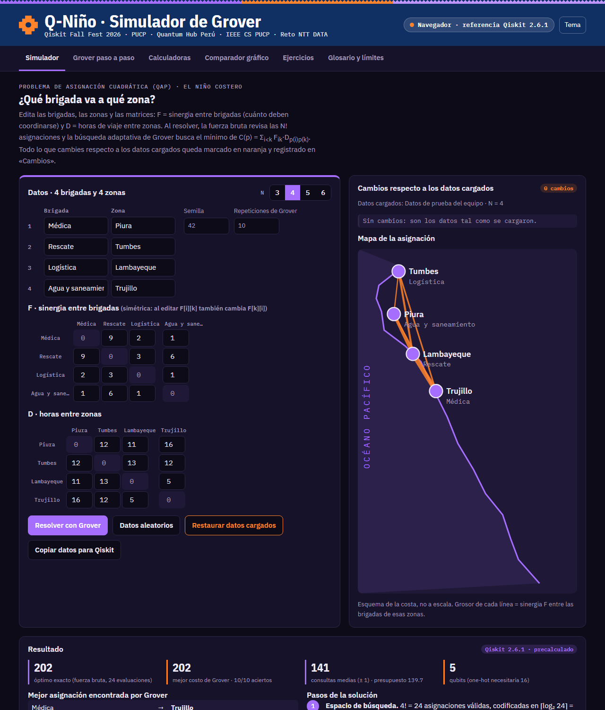

> **En una frase:** asignamos brigadas de emergencia (Médica, Rescate, Logística…) a zonas de riesgo (Piura, Tumbes, Chosica…) minimizando el tiempo de coordinación. Después de probar QAOA y QUBO, elegimos la **búsqueda adaptativa de Grover** con una codificación que solo representa asignaciones válidas. En nuestras pruebas encontró el óptimo en **40 de 40 ejecuciones** (N = 3 a 6) y usa ⌈log₂ N!⌉ qubits en lugar de N².

---

## Índice

1. [El problema](#1-el-problema)
2. [Modelo matemático](#2-modelo-matemático)
3. [Datos y fuentes](#3-datos-y-fuentes)
4. [Cómo llegamos al prototipo: cuatro experimentos](#4-cómo-llegamos-al-prototipo-cuatro-experimentos)
5. [Por qué elegimos Grover](#5-por-qué-elegimos-grover)
6. [El algoritmo final: Grover Adaptive Search](#6-el-algoritmo-final-grover-adaptive-search)
7. [Resultados finales](#7-resultados-finales)
8. [El prototipo web](#8-el-prototipo-web)
9. [Cómo ejecutarlo](#9-cómo-ejecutarlo)
10. [Estructura del repositorio](#10-estructura-del-repositorio)
11. [Limitaciones y trabajo futuro](#11-limitaciones-y-trabajo-futuro)
12. [Notas de honestidad](#12-notas-de-honestidad)
13. [Créditos y herramientas](#13-créditos-y-herramientas)

---

## 1. El problema

El reto de NTT DATA plantea un Problema de Asignación Cuadrática (QAP): asignar N elementos a N ubicaciones, por ejemplo vuelos a puertas de embarque, minimizando un costo que depende de **pares** de asignaciones. Las bases permiten adaptar el contexto, y nosotros lo llevamos a la **logística humanitaria frente al Fenómeno de El Niño en el Perú**:

| Elemento del QAP | En nuestro caso |
|---|---|
| Elementos *i, k* | Brigadas: Médica, Rescate, Logística, Agua y saneamiento, Comunicaciones, Albergue |
| Ubicaciones *j, l* | Zonas de riesgo: Piura, Tumbes, Lambayeque, Trujillo, Chosica, Ica |
| Flujo F<sub>ik</sub> | Sinergia: cuánto necesitan coordinarse dos brigadas |
| Distancia D<sub>jl</sub> | Horas de viaje entre zonas, que aumentan si una carretera se bloquea |

**Objetivo:** que las brigadas que más se coordinan queden en zonas cercanas, para reducir el tiempo total de respuesta.

## 2. Modelo matemático

Una asignación es una permutación *p*, donde *p(i)* es la zona de la brigada *i*:

```
C(p) = Σ_{i<k} F[i][k] · D[p(i)][p(k)]
```

Cada par de brigadas se cuenta **una sola vez**, que es la convención del reto. En código: `(F * D[np.ix_(p, p)]).sum() / 2`, válido porque F y D son simétricas y tienen diagonal 0.

En la formulación QUBO clásica (la usamos en los experimentos 1 a 3), con variables binarias x<sub>ij</sub> = 1 si la brigada *i* va a la zona *j*:

```
min  Σ_{i≠k} Σ_{j≠l} (F_ik · D_jl / 2) · x_ij · x_kl
s.a. Σ_j x_ij = 1  ∀i      (cada brigada en una zona)
     Σ_i x_ij = 1  ∀j      (cada zona con una brigada)
```

Qiskit convierte esas igualdades en penalizaciones λ·(1 − Σx)² y el problema queda como un Hamiltoniano de Ising con **N² qubits**.

## 3. Datos y fuentes

El equipo identificó fuentes oficiales y abiertas para construir F y D con datos reales (detalle en [`docs/proceso/fuentes_de_datos.html`](docs/proceso/fuentes_de_datos.html)):

| Fuente | Qué aporta | Uso en el QAP |
|---|---|---|
| [SENAMHI](https://www.senamhi.gob.pe) | Pronósticos, Índice Costero El Niño (ICEN), lluvias históricas (1983, 1998, 2017) | Elegir las zonas de mayor riesgo |
| [INDECI](https://www.gob.pe/indeci) | Emergencias, damnificados y afectados por distrito | Pesos del flujo F |
| [OpenStreetMap](https://www.openstreetmap.org) y [Openrouteservice](https://openrouteservice.org) | Red vial y matrices de tiempo de viaje | Matriz D en horas |
| [HDX (OCHA, ONU)](https://data.humdata.org) | Datasets de Perú ya limpios (vías, salud) | Escalar a N = 10 |
| [Datos Abiertos (INEI, SUSALUD)](https://datosabiertos.gob.pe) | Centros de salud, población vulnerable | Tipos y número de brigadas |

**Estado actual, con honestidad:** los experimentos y el prototipo usan **matrices de prueba**. Son supuestos ilustrativos en los experimentos 1 y 2, y matrices aleatorias reproducibles (semilla 42) en el 3, el 4 y el prototipo. Las matrices de qap10 del reto y los datos reales de las fuentes de arriba quedan como siguiente paso (ver [§11](#11-limitaciones-y-trabajo-futuro)).

## 4. Cómo llegamos al prototipo: cuatro experimentos

Los cuatro notebooks originales (Google Colab) están en [`docs/proceso/`](docs/proceso/). En cada uno comparamos un enfoque cuántico contra la **fuerza bruta clásica**, que revisa las N! permutaciones y da el óptimo exacto.

### Experimento 1 · QAOA con QUBO one-hot ([`untitled3.py`](docs/proceso/untitled3.py))

- **Datos (N = 3):** brigadas Médica, Logística y Rescate; zonas Piura, Chosica y Tumbes; F = [[0,3,2],[3,0,5],[2,5,0]], D = [[0,10,8],[10,0,15],[8,15,0]] horas.
- **Método:** `QuadraticProgram` con 9 variables x<sub>ij</sub>, restricciones de asignación única y `QAOA` (`StatevectorSampler`, `COBYLA(maxiter=100)`, `reps=2`) dentro de `MinimumEigenOptimizer`.

| Método | Costo | Tiempo |
|---|---|---|
| Fuerza bruta (exacto) | 100 horas | 0,000887 s |
| QAOA (simulado, 9 qubits) | 100 horas | **503,26 s** |

Asignación óptima: Médica → Chosica, Logística → Piura, Rescate → Tumbes. Gap de calidad: 0,00 %.

<p align="center">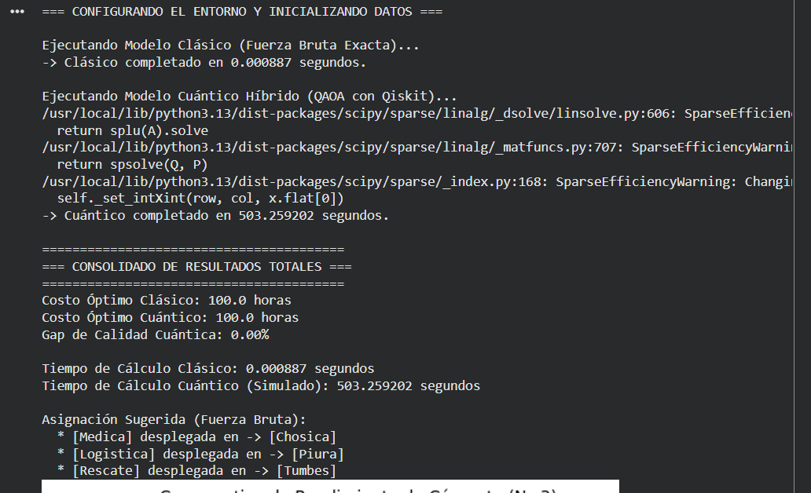 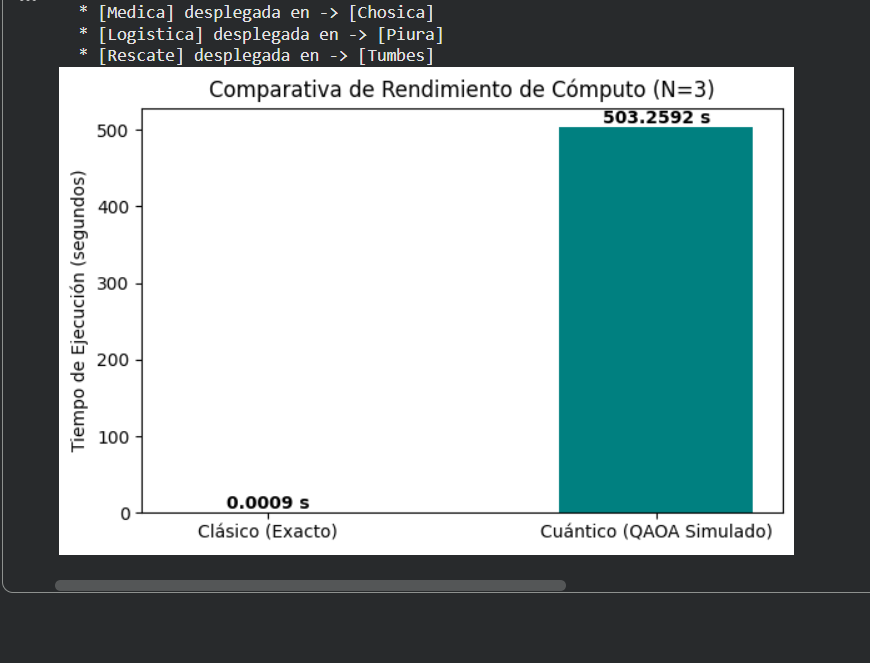</p>

**Lectura:** QAOA encontró el óptimo, pero simularlo tomó más de 8 minutos para un problema de 6 combinaciones. La optimización variacional (COBYLA ajustando ángulos) sobre 9 qubits con penalizaciones es lenta y no da garantías. En una prueba previa con QAOA sobre otro problema de 16 qubits (una ruta de 4 puntos), 7 de 12 ejecuciones devolvieron soluciones que violaban las restricciones.

### Experimento 2 · QUBO resuelto de forma exacta ([`untitled4.py`](docs/proceso/untitled4.py))

- **Mismos datos.** Se convierte el modelo con `QuadraticProgramToQubo` y se resuelve con `NumPyMinimumEigensolver`, que diagonaliza el Hamiltoniano de forma exacta.

| Método | Costo | Factible | Tiempo |
|---|---|---|---|
| Fuerza bruta | 100 horas | Sí | 0,000700 s |
| QUBO exacto (9 variables) | 100 horas | **Sí** | 0,273410 s (390,8 veces el clásico) |

<p align="center">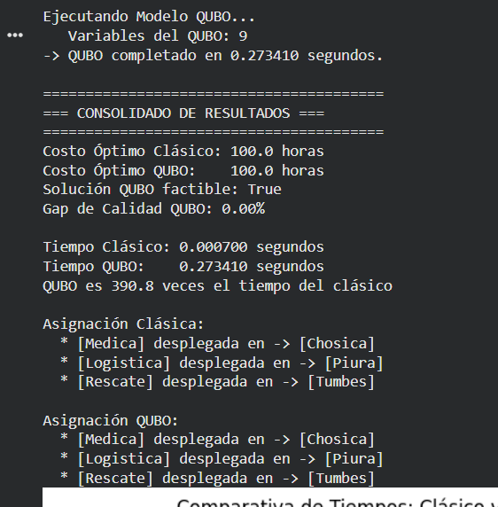 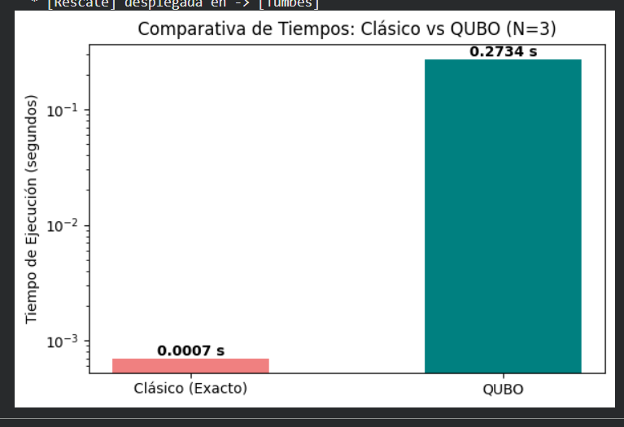</p>

**Lectura:** la formulación QUBO es **correcta**: su mínimo coincide con el óptimo y respeta las restricciones. Pero resolverla diagonalizando es un método clásico que crece con 2<sup>N²</sup>.

### Experimento 3 · ¿Cómo escala? ([`untitled5.py`](docs/proceso/untitled5.py))

Para medir el crecimiento usamos matrices aleatorias reproducibles (`generar_datos(n)`, semilla 42 + n) con N de 3 a 9.

<p align="center">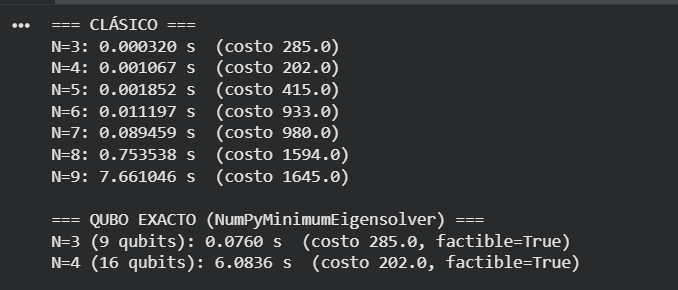</p>

| N | N! | Fuerza bruta | Costo óptimo | QUBO exacto (qubits) | QUBO exacto (tiempo) |
|---|---|---|---|---|---|
| 3 | 6 | 0,00032 s | 285 | 9 | 0,0760 s |
| 4 | 24 | 0,00107 s | 202 | 16 | 6,0836 s |
| 5 | 120 | 0,00185 s | 415 | 25 | no ejecutado |
| 6 | 720 | 0,01120 s | 933 | 36 | — |
| 7 | 5 040 | 0,0895 s | 980 | 49 | — |
| 8 | 40 320 | 0,7535 s | 1 594 | 64 | — |
| 9 | 362 880 | 7,661 s | 1 645 | 81 | — |

Memoria del vector de estado con la codificación one-hot (2<sup>N²</sup> amplitudes × 16 bytes; el notebook la calcula en su sección «Por qué no escala»):

| N | Qubits (N²) | Memoria del statevector |
|---|---|---|
| 4 | 16 | ≈ 1 MB |
| 5 | 25 | ≈ 0,54 GB |
| 6 | 36 | ≈ 1,1 TB |
| 7 | 49 | ≈ 9 PB |

**Lectura:** la codificación one-hot es el cuello de botella. Usa N² qubits, la gran mayoría de sus 2<sup>N²</sup> estados son asignaciones inválidas y la simulación se vuelve imposible desde N = 6. Este notebook también corre QAOA para N = 3 y 4, pero esa salida no quedó en la captura.

### Experimento 4 · Grover con codificación por índice ([`untitled6.py`](docs/proceso/untitled6.py))

El cambio clave: en lugar de N² qubits one-hot, **numeramos cada permutación válida** de 0 a N!−1 y guardamos ese número en binario.

| | QUBO one-hot | Índice de permutación (Grover) |
|---|---|---|
| Qubits para N = 4 | 16 | **5** |
| Qubits para N = 6 | 36 | **10** |
| Qubits para N = 10 | 100 | **22** |
| Qubits para N = 14 | 196 | **37** |
| ¿Puede salir una solución inválida? | Sí | **No** |
| ¿Necesita penalización λ? | Sí | **No** |

Sobre esa codificación se aplica la **búsqueda adaptativa de Grover** (Dürr–Høyer con la estrategia BBHT), explicada en [§6](#6-el-algoritmo-final-grover-adaptive-search). Resultado del notebook original (5 repeticiones por N):

<p align="center">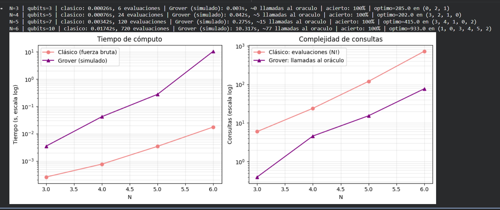</p>

| N | Qubits | Evaluaciones clásicas (N!) | Llamadas al oráculo (Grover) | Acierto | Óptimo |
|---|---|---|---|---|---|
| 3 | 3 | 6 | ~0 | 100 % | 285 |
| 4 | 5 | 24 | ~5 | 100 % | 202 |
| 5 | 7 | 120 | ~15 | 100 % | 415 |
| 6 | 10 | 720 | ~77 | 100 % | 933 |

**Lectura:** Grover encontró el óptimo en todas las repeticiones, con las mismas matrices del experimento 3. Hay un matiz importante: esos números bajos de llamadas dependen de una **parada anticipada** (`if not marcados: break`) que usa información clásica para saber que ya no hay nada mejor. Por eso en el prototipo final la quitamos y medimos de forma honesta ([§7](#7-resultados-finales)).

### Resumen de los cuatro experimentos

| Experimento | Enfoque | Qubits (N = 3) | ¿Óptimo? | ¿Garantiza factibilidad? | Conclusión |
|---|---|---|---|---|---|
| 1 | QAOA + QUBO one-hot | 9 | Sí, en N = 3 | No | Muy lento y sin garantías al escalar |
| 2 | QUBO exacto (NumPy) | 9 | Sí | Sí | Valida el modelo, pero no es cuántico |
| 3 | Escalamiento | N² | — | — | One-hot no escala |
| 4 | **Grover + índice** | **3** | **Sí, 100 %** | **Sí, por construcción** | **Elegido** |

## 5. Por qué elegimos Grover

Resumen del análisis del equipo ([`docs/proceso/por_que_grover.docx`](docs/proceso/por_que_grover.docx)):

**En tiempo, Grover no se acercó al clásico; se alejó.** En simulación tarda unas 12 veces más que la fuerza bruta en N = 3 y unas 590 veces más en N = 6, porque cada qubit extra duplica el costo de simular. **Donde sí se acerca es en las consultas:** de 24 evaluaciones a ~5 llamadas en N = 4, de 120 a ~15 en N = 5 y de 720 a ~77 en N = 6. La ventaja crece con N. Con tan pocos datos lo presentamos como una tendencia, no como una ley.

**Ventajas:**
- **Menos consultas a la función de costo:** del orden de √(N!) frente a N!. Es la mejora óptima para búsqueda sin estructura.
- **Codificación compacta:** N! asignaciones caben en ⌈log₂(N!)⌉ qubits (10 qubits para 720 casos).
- **Oráculo general:** no exige que la función sea convexa ni diferenciable. Una restricción nueva, como una zona bloqueada o dos brigadas incompatibles, se agrega modificando el oráculo.
- **Garantía de optimalidad probabilística:** a diferencia de QAOA, nunca devuelve una asignación infactible, y mejora la solución paso a paso, así que puede detenerse en cualquier momento con la mejor hallada.
- **Subrutina de otros algoritmos:** la amplificación de amplitud puede acelerar de forma cuadrática el backtracking y el *branch and bound*, que son los métodos exactos clásicos más usados para el QAP.

**Límites que reconocemos:**
- √(N!) sigue siendo super-exponencial: Grover no vuelve tratable el problema, solo lo abarata.
- El oráculo no es gratis: en hardware real cada consulta requiere un circuito reversible que calcule el costo.
- La sobrecarga de corrección de errores podría anular una ventaja solo cuadrática (Babbush et al., 2021, *Focus beyond quadratic speedups for error-corrected quantum advantage*).
- Existen heurísticas y solvers clásicos muy buenos para el QAP que no recorren las N! permutaciones.

**Conclusión:** en simulación Grover no ofrece ventaja de tiempo, pero muestra una reducción creciente de consultas al oráculo, que es el indicio de ventaja teórica. Esa ventaja solo podría materializarse con hardware tolerante a fallos y un oráculo eficiente.

## 6. El algoritmo final: Grover Adaptive Search

Implementado en [`qiskit_grover.py`](qiskit_grover.py) a partir de `untitled6.py`:

```
y ← índice aleatorio (umbral inicial);  m ← 1
mientras consultas < 22,5·√M + 1,4·log₂²M:         # M = N!, cota de Dürr–Høyer
    marcados ← {i : costo[i] < costo[y]}            # oráculo de fase −1
    j ← entero aleatorio en [0, ⌈m⌉)                # BBHT: no sabemos cuántos están marcados
    salida ← medir( H^n · (oráculo · difusión)^j )
    consultas += max(j, 1)
    si salida < M y costo[salida] < costo[y]:  y ← salida;  m ← 1
    si no:                                     m ← min(1,2·m, √M)
devolver y
```

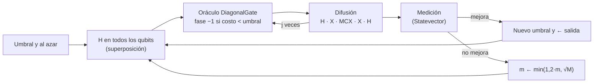

**Qué hace Qiskit:**
- `QuantumCircuit` con `h`, `x` y `mcx`: superposición y difusión 2|s⟩⟨s| − I.
- `DiagonalGate` (`qiskit.circuit.library`): el oráculo de fase. El notebook original usaba `Diagonal`, que Qiskit 2.1+ marca como obsoleta.
- `Statevector`: amplitudes exactas y probabilidades de medición.

**Cambios respecto al notebook original:**
1. Quitamos la parada anticipada `if not marcados: break` (versión honesta): cada ejecución termina solo al agotar el presupuesto de consultas.
2. Cambiamos `Diagonal` por `DiagonalGate`.
3. 10 repeticiones por N en lugar de 5.
4. Guardamos la traza completa (umbral, marcados, j, medición y amplitudes de cada etapa) para animarla en la web.
5. Agregamos la función `resolver_instancia` para resolver cualquier matriz, que usan el backend y la opción `--datos`.

## 7. Resultados finales

Qiskit 2.6.1, semilla 42, 10 ejecuciones por N y sin parada anticipada:

| N | Qubits (índice) | Qubits (one-hot) | N! | Presupuesto | Consultas medidas | Acierto | Óptimo | Fuerza bruta | Grover simulado |
|---|---|---|---|---|---|---|---|---|---|
| 3 | 3 | 9 | 6 | 64,5 | 65 ± 0 | 10/10 | 285 | 0,3 ms | 0,08 s |
| 4 | 5 | 16 | 24 | 139,7 | 141 ± 1 | 10/10 | 202 | 1 ms | 0,69 s |
| 5 | 7 | 25 | 120 | 313,3 | 315 ± 1 | 10/10 | 415 | 2 ms | 3,40 s |
| 6 | 10 | 36 | 720 | 729,7 | 736 ± 4 | 10/10 | 933 | 12 ms | 44,86 s |

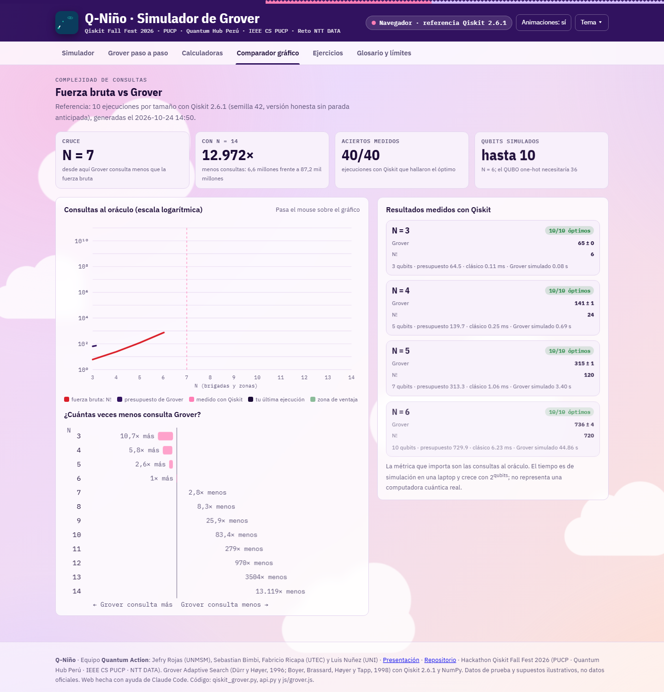

**Cómo leerlo:**
- **Calidad:** el óptimo se encontró en 40 de 40 ejecuciones, y ninguna medición devolvió una asignación inválida.
- **Consultas:** con la cota de Dürr–Høyer, para N ≤ 6 Grover usa **más** consultas que N!, por la constante 22,5. Según la fórmula, la ventaja aparece desde **N ≈ 7** (presupuesto ÷ N! = 0,36), y en N = 14 sería de 6,6 millones de consultas frente a 87 mil millones.
- **Tiempo:** el tiempo simulado no mide una computadora cuántica real; simular 2<sup>qubits</sup> amplitudes es exponencial en una laptop.

## 8. El prototipo web

**https://q-nino.vercel.app**: un simulador editable con seis secciones.

| Sección | Qué permite |
|---|---|
| **Simulador** | Sin escribir nada: elegir N (3–6), brigadas y zonas de listas, y ajustar cada celda de F y D con un deslizador o atajos (Baja, Media, Alta). D se puede estimar desde el mapa. Semilla y repeticiones también se eligen de listas. Cada cambio frente a los datos cargados se marca en rosa y se registra («F[Médica, Rescate]: 9 → 14»). Muestra el resultado, el mapa de la costa y los pasos de la solución |
| **Grover paso a paso** | Anima cada etapa (superposición → oráculo → difusión → medición) con las amplitudes de cada índice, la línea del promedio y la evolución del umbral frente a las consultas |
| **Calculadoras** | Costo de una asignación (desglose por pares), qubits y presupuesto para cualquier N, iteraciones óptimas de Grover (simulación frente a sin²((2j+1)θ)) y conversor índice ↔ asignación |
| **Comparador gráfico** | N! frente al presupuesto de Grover frente a las consultas medidas, en escala logarítmica hasta N = 14 |
| **Ejercicios** | Casos para cargar con un clic: el caso N = 3 de la guía, los 4 casos verificados con Qiskit y los casos qap10 (pendientes) |
| **Glosario y límites** | Términos, fórmulas, uso de Qiskit, el circuito impreso por Qiskit y las limitaciones |

<p align="center">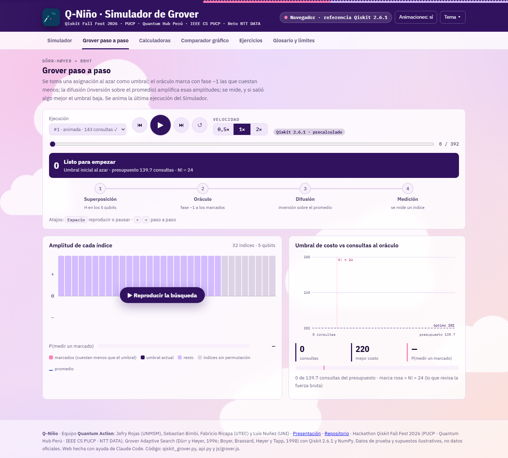 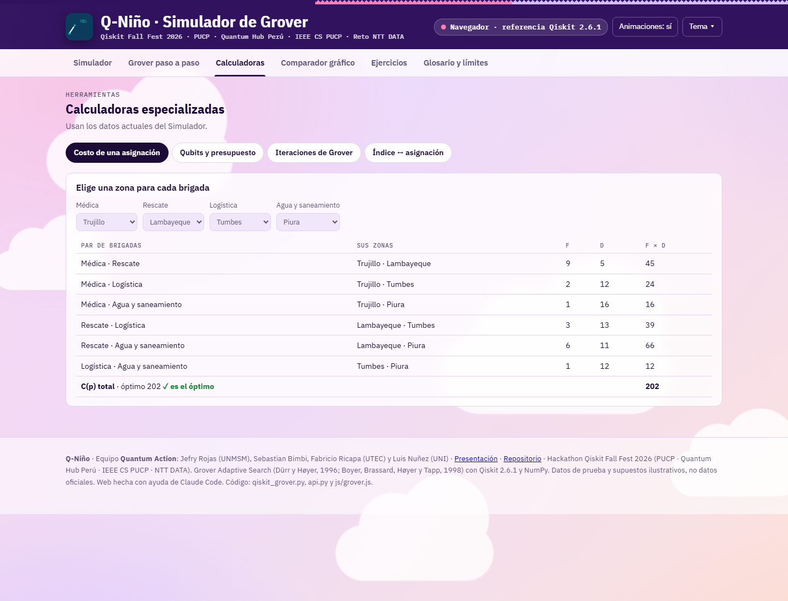</p>

**Arquitectura:**

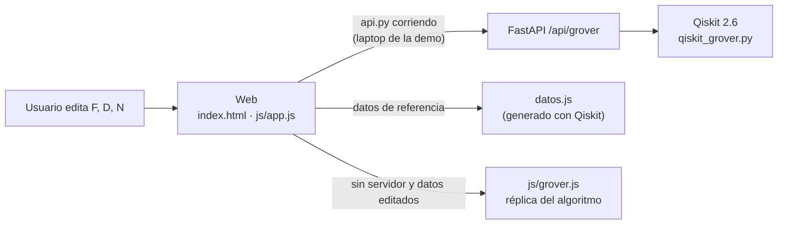

El indicador de la cabecera dice siempre qué motor calculó el resultado:
- **«Qiskit en vivo»:** el backend local ejecuta Qiskit con los datos editados.
- **«Qiskit precalculado»:** los datos originales, verificados con Qiskit (`datos.js`).
- **«Navegador»:** en Vercel, si se editan los datos, una réplica en JavaScript del mismo algoritmo recalcula al instante. Los resultados oficiales salen de Qiskit.

**Diseño:** paleta tomada del arte oficial del Qiskit Fall Fest 2026: fondo lavanda (`#DBE4FC`), rosa de la insignia (`#FF7EB5`), morado de la pastilla «Quantum» (`#31125F`), azul del ala (`#1A41BF`) y lila (`#D4BCFF`), con la tipografía IBM Plex. La identidad peruana se ve en la banda textil y el mapa de la costa. Los colores están en el primer bloque de `css/styles.css`.

**Logo y animaciones:** el logo (una ruta entre montañas con un qubit en la cumbre, `img/logo.svg`) se dibuja al cargar y su qubit orbita. Hay transiciones al cambiar de sección, tarjetas que entran en cascada, contadores en los resultados, un destello en cada celda editada, el mapa que se enciende al resolver y un pulso en cada etapa de Grover. Están activadas por defecto. El botón **«Animaciones»** de la cabecera las apaga para quien prefiera menos movimiento, y la elección se recuerda.

## 9. Cómo ejecutarlo

```bash
git clone https://github.com/GatitoFBI/IBM-QUAMTUM-HACKATON-PROTOTIPO.git
cd IBM-QUAMTUM-HACKATON-PROTOTIPO
python -m venv .venv
.venv\Scripts\python.exe -m pip install -r requirements.txt   # en Linux/macOS: .venv/bin/python
```

| Qué | Comando |
|---|---|
| Web + Qiskit en vivo (modo demo) | `.venv\Scripts\python.exe api.py` y abrir http://127.0.0.1:8000 |
| Regenerar los resultados de referencia (~8 min) | `.venv\Scripts\python.exe -u qiskit_grover.py` |
| Resolver datos copiados desde la web | `.venv\Scripts\python.exe qiskit_grover.py --datos datos.json` |
| Tests del núcleo cuántico | `.venv\Scripts\python.exe -m pytest -q` |
| Solo la web, sin Python | abrir `index.html` con doble clic |

Los tests verifican que Grover encuentra el óptimo de N = 3 (285) y que una iteración con 1 marcado entre 8 da exactamente 25/32.

## 10. Estructura del repositorio

| Ruta | Contenido |
|---|---|
| `qiskit_grover.py` | Núcleo cuántico: datos, fuerza bruta, oráculo, difusión, Grover adaptativo y generación de `datos.js` |
| `api.py` | Backend FastAPI: `/api/salud`, `/api/grover` (con validación de entradas) y sirve la web |
| `test_grover.py` | Tests pytest |
| `datos.js` | Resultados de referencia generados con Qiskit |
| `index.html`, `css/styles.css`, `js/app.js` | Interfaz |
| `js/grover.js` | Réplica del algoritmo en el navegador |
| `docs/proceso/` | Material original del equipo: notebooks `untitled3.py` a `untitled6.py`, guía estratégica, reporte de fuentes, borrador de presentación y análisis `por_que_grover.docx` |
| `docs/img/` | Capturas de los experimentos y del prototipo |
| `requirements.txt` | qiskit 2.6.1, numpy, pytest, fastapi, uvicorn |

Los notebooks de `docs/proceso/` son exportaciones de Google Colab: empiezan con `!pip install …` y usan `qiskit-algorithms`. El código final (`qiskit_grover.py`) solo necesita `qiskit` y `numpy`.

## 11. Limitaciones y trabajo futuro

1. **Oráculo idealizado.** Para marcar estados, la simulación revisa la tabla de costos, que ya cuesta N! evaluaciones clásicas. En hardware real el oráculo debe calcular el costo dentro del circuito con aritmética reversible, con muchos qubits auxiliares y mucha profundidad. Por eso reportamos **consultas**, no tiempo.
2. **Simulación limitada.** N = 10 necesita 22 qubits y N = 14, 37: no se pueden simular con statevector. Para esos tamaños, el siguiente paso es la **descomposición** en subproblemas pequeños (por ejemplo, regiones norte, centro y sur), cada uno resuelto con Grover.
3. **Hardware actual.** El ruido de los procesadores de hoy no permitiría un oráculo tan profundo.
4. **Datos.** Falta usar las matrices de **qap10** y validar sus óptimos de control (**24** para N = 3, **32** para N = 4 y **340** para N = 10), y construir F y D con INDECI, SENAMHI y Openrouteservice (§3).
5. **Ventaja estadística.** Con 10 repeticiones por N, las cifras son una tendencia; habría que reportar más semillas.

## 12. Notas de honestidad

- **Borrador de presentación.** [`docs/proceso/presentacion_borrador.html`](docs/proceso/presentacion_borrador.html) muestra «34 horas» y «QAOA ~2,5 s» como resultados de N = 3. Eran valores de ejemplo de la plantilla, no mediciones. Los resultados reales son 100 horas y 503 s (experimento 1).
- **Matrices de los experimentos 1 y 2.** Están marcadas en el código como «corregidas» respecto a la guía (F = [[0,8,2],…], D = [[0,12,8],…]), y el notebook 2 avisa que son valores de muestra. Los cargamos en la web como el caso «Guía del equipo» para que se puedan comparar.
- **Tiempos del reporte de fuentes.** Los tiempos Piura–Tumbes (3,5 h), Piura–Chosica (14 h) y Tumbes–Chosica (16,5 h) son estimaciones que falta verificar con Openrouteservice antes de citarlas.
- **Comparación de tiempos.** La tabla de costos se calcula fuera del cronómetro de Grover, y el tiempo de simulación no representa el de una QPU.

## 13. Créditos y herramientas

- **Qiskit 2.6.1** (IBM Quantum), qiskit-optimization y qiskit-algorithms (en los experimentos), NumPy y Matplotlib.
- **Algoritmos:** C. Dürr y P. Høyer (1996), *A quantum algorithm for finding the minimum*; M. Boyer, G. Brassard, P. Høyer y A. Tapp (1998), *Tight bounds on quantum searching*; L. Grover (1996).
- **Referencia sobre límites:** R. Babbush et al. (2021), *Focus beyond quadratic speedups for error-corrected quantum advantage*, PRX Quantum.
- **Herramientas:** Google Colab (experimentos), FastAPI y Uvicorn (backend), Leaflet y mapas de © colaboradores de OpenStreetMap (mapa del simulador), Vercel (despliegue). La web, el backend y esta documentación se hicieron con ayuda de **Claude Code** (Anthropic), a partir del código y los análisis del equipo.
