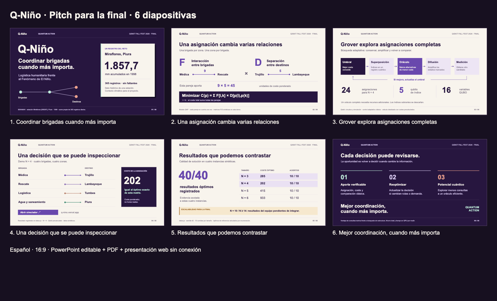

# Q-Niño · Diapositivas del pitch final

Seis diapositivas en español, formato 16:9, correspondientes a las seis pantallas del [guion de cuatro minutos](../guion_4min_ES.txt). Incluyen notas y tiempos para cada expositor.

| Formato | Uso |
|---|---|
| [Ver PDF](Q_Nino_Pitch_Final_4min.pdf) | Presentar o compartir las seis diapositivas |
| [PowerPoint editable](Q_Nino_Pitch_Final_4min.pptx) | Editar texto y formas, y consultar las notas del presentador |
| [HTML sin conexión](Q_Nino_Pitch_Final_4min.html) | Descargar y abrir en el navegador, sin servidor |
| [Descargar el paquete ZIP](Q_Nino_Slides_Final.zip) | Los tres formatos, notas, vista previa e instrucciones |
| [Notas del presentador](NOTAS_PRESENTADOR.txt) | Locución y transiciones por diapositiva |

## Reparto y tiempos

| Pantalla | Contenido | Expositor | Tiempo objetivo |
|---|---|---|---|
| 1 | Problema y dato histórico de SENAMHI | Sebastian | 0:00–0:30 |
| 2 | Modelo de asignación cuadrática | Jefry | 0:30–1:10 |
| 3 | Grover adaptativo con Qiskit | Luis | 1:10–1:55 |
| 4 | Demo N = 4, coste 202 | Luis | 1:55–2:20 |
| 5 | Resultados registrados y escalabilidad | Jefry | 2:20–3:00 |
| 6 | Aporte y oportunidades; cierre | Fabricio y Sebastian | 3:00–3:45 |

Quedan 15 segundos de margen. Los tiempos son objetivos para el ensayo, no una duración de presentación medida.

**Pendiente:** la diapositiva 5 mantiene visible que falta integrar los resultados N = 10 / N ≥ 14 del equipo. Sustituir esa franja con las mediciones reales antes de cerrar la presentación.

## Cómo presentar

En PowerPoint, abrir las notas del presentador para seguir el guion. En el HTML descargado, usar las flechas o espacio para avanzar, `N` para mostrar notas y `F` para pantalla completa. GitHub muestra el código del HTML; para presentar, descargarlo y abrirlo localmente.

Preparar el simulador en N = 4 antes de empezar. La diapositiva 4 enlaza al simulador y conserva una asignación registrada de coste 202 como respaldo sin conexión. Los enlaces a la demo y a las fuentes requieren internet.

Los datos climáticos sustentan el contexto; las matrices F/D y los experimentos de la demo siguen siendo sintéticos. La oportunidad de menos consultas es teórica y el tiempo de ejecución en QPU está por medir. Las fuentes están en las notas y en el [paquete de evidencia del pitch](../README.md).

Los archivos coinciden con los entregados para ensayo en Downloads. [MANIFEST.json](MANIFEST.json) registra sus tamaños y huellas SHA-256; [LEEME.txt](LEEME.txt) contiene las instrucciones completas y el alcance de la verificación.
