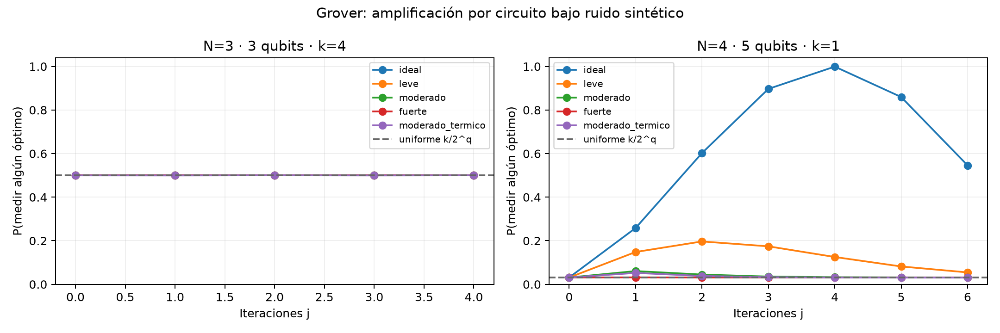

# Informe de ruido en Grover Adaptive Search

Q-Niño · QAP de asignación de brigadas · 25 de octubre de 2026

Este informe documenta las pruebas del archivo qiskit_grover.py, explica cada tabla y propone medidas para reducir el efecto del ruido. Incluye resultados completos de N=3 y N=4, un diagnóstico de amplificación por circuito y una evaluación adicional de compilación optimizada. Los perfiles son sintéticos: los resultados describen este simulador y estas instancias, no una calibración o ejecución de un procesador IBM.

## 1. Resultado principal y decisión recomendada

El algoritmo puede seguir encontrando el óptimo gracias a los reintentos, aunque el ruido haya deteriorado la amplificación cuántica. Para N=4, el éxito final pasa de 100/100 en ideal a 94/100 en ruido moderado, 88/100 en fuerte y 90/100 al añadir relajación T1/T2 al moderado. El control uniforme también logra 100/100 en estos grupos; no se ha demostrado ventaja cuántica.

| Perfil N=4 | Óptimos finales | IC Wilson 95 % | P óptimo, circuito j=4 |
| --- | --- | --- | --- |
| Ideal | 100/100 | 96,30 % a 100,00 % | 99,9182 % |
| Leve | 100/100 | 96,30 % a 100,00 % | 12,5333 % |
| Moderado | 94/100 | 87,52 % a 97,22 % | 3,2482 % |
| Fuerte | 88/100 | 80,19 % a 93,00 % | 3,1250 % |
| Moderado + T1/T2 | 90/100 | 82,56 % a 94,48 % | 3,1191 % |

Prioridad recomendada: reducir puertas y profundidad; después estudiar un número de iteraciones adaptado al ruido y al umbral, y finalmente calibrar y mitigar la lectura si se trabaja con distribuciones de muchos shots. DD, twirling y ZNE requieren condiciones específicas y no se deben activar como una receta universal. La sección 9 diferencia evidencia ya medida, hipótesis por validar y técnicas que no corrigen este flujo de una sola muestra.

El PDF muestra todos los agregados y los barridos completos con redondeo legible. El Excel conserva los campos numéricos y todos los registros; los CSV y JSON originales del paquete son la referencia de precisión para reproducciones y auditorías.

## 2. Procedencia, alcance y entorno

| Elemento | Valor |
| --- | --- |
| Repositorio | GatitoFBI/IBM-QUAMTUM-HACKATON-PROTOTIPO |
| Revisión base | 9a471806931d3e78d749499cd13019d9e300fbb4 |
| Archivo recibido | /Users/sebasbimbi/Downloads/qiskit_grover.py |
| Campaña principal UTC | 2026-10-25T15:23:53.166001+00:00 |
| Python del experimento | 3.14.7 · macOS ARM64 |
| Versiones | qiskit 2.6.1, qiskit-aer 0.17.2, numpy 2.5.4, pytest 9.1.1, matplotlib 3.11.2 |
| Instancias completas | Una matriz F y D fija por tamaño: N=3 y N=4 |
| Semillas de búsqueda | 42 a 141 inclusive; 100 por tamaño y perfil |
| Método | Aer density_matrix; un hilo; precisión de doble flotante |
| Compilación inicial | rz/sx/x/cx; optimization_level=0; seed_transpiler=42 |
| Conectividad | Sin coupling_map, routing, backend físico ni calibración |
| Tamaños restantes | N=5: ensayo preliminar y campaña incompleta por timeout. N=6: no ejecutado |

El SHA-256 del archivo de Downloads coincide con el del núcleo importado del repositorio. Se conservó el original; la simulación de ruido se implementó en un módulo separado. Los errores se aplican después de descomponer las puertas DiagonalGate y mcx a la base declarada, para que el modelo actúe sobre las instrucciones realmente ejecutadas.

SHA-256 original y Downloads: c71fdca73a6f9a0d9ae4e179ec83d3b4962fc084b21abc4c18ada240a462e409

SHA-256 del benchmark de la campaña principal: 1e35e30bc14e6e43e09e44c5beab1613798d8073886f66475eddb0c1753ff092

## 3. Problema e instancias exactas

Cada estado válido representa una permutación p que asigna brigadas a zonas. El costo es C(p)=Σ(i<k) F[i,k]·D[p(i),p(k)]. F y D son simétricas con diagonal cero. Se enumeran las N! permutaciones en el orden lexicográfico de itertools.permutations(range(N)); el índice del estado identifica esa fila de la tabla de costos. La tabla se calcula clásicamente antes de la búsqueda y también proporciona el óptimo de control.

Las matrices son sintéticas reproducibles. generar_datos(N) usa default_rng(42+N): semilla 45 para N=3 y 46 para N=4. Se toman enteros de [1,10) para F y [5,20) para D, se conserva el triángulo superior y se suma su transpuesta. No son mediciones de tiempos reales de respuesta.

| N | N! | Qubits q | Estados 2^q | Padding | Óptimo | Índices óptimos | Presupuesto B |
| --- | --- | --- | --- | --- | --- | --- | --- |
| 3 | 6 | 3 | 8 | 2 | 285 | 1, 3, 4, 5 | 64,468363 |
| 4 | 24 | 5 | 32 | 8 | 202 | 23 | 139,657672 |

### 3.1. Matrices y costos de N=3

Matriz F; índices desde cero.

| Fila | 0 | 1 | 2 |
| --- | --- | --- | --- |
| 0 | 0 | 6 | 7 |
| 1 | 6 | 0 | 7 |
| 2 | 7 | 7 | 0 |

Matriz D; índices desde cero.

| Fila | 0 | 1 | 2 |
| --- | --- | --- | --- |
| 0 | 0 | 11 | 16 |
| 1 | 11 | 0 | 16 |
| 2 | 16 | 16 | 0 |

| Índice | Permutación p | Costo C(p) | Es óptimo |
| --- | --- | --- | --- |
| 0 | [0, 1, 2] | 290 | No |
| 1 | [0, 2, 1] | 285 | Sí |
| 2 | [1, 0, 2] | 290 | No |
| 3 | [1, 2, 0] | 285 | Sí |
| 4 | [2, 0, 1] | 285 | Sí |
| 5 | [2, 1, 0] | 285 | Sí |

### 3.2. Matrices y costos de N=4

Matriz F; índices desde cero.

| Fila | 0 | 1 | 2 | 3 |
| --- | --- | --- | --- | --- |
| 0 | 0 | 9 | 2 | 1 |
| 1 | 9 | 0 | 3 | 6 |
| 2 | 2 | 3 | 0 | 1 |
| 3 | 1 | 6 | 1 | 0 |

Matriz D; índices desde cero.

| Fila | 0 | 1 | 2 | 3 |
| --- | --- | --- | --- | --- |
| 0 | 0 | 12 | 11 | 16 |
| 1 | 12 | 0 | 13 | 12 |
| 2 | 11 | 13 | 0 | 5 |
| 3 | 16 | 12 | 5 | 0 |

| Índice | Permutación p | Costo C(p) | Es óptimo |
| --- | --- | --- | --- |
| 0 | [0, 1, 2, 3] | 262 | No |
| 1 | [0, 1, 3, 2] | 270 | No |
| 2 | [0, 2, 1, 3] | 220 | No |
| 3 | [0, 2, 3, 1] | 248 | No |
| 4 | [0, 3, 1, 2] | 258 | No |
| 5 | [0, 3, 2, 1] | 278 | No |
| 6 | [1, 0, 2, 3] | 280 | No |
| 7 | [1, 0, 3, 2] | 264 | No |
| 8 | [1, 2, 0, 3] | 232 | No |
| 9 | [1, 2, 3, 0] | 250 | No |
| 10 | [1, 3, 0, 2] | 234 | No |
| 11 | [1, 3, 2, 0] | 268 | No |
| 12 | [2, 0, 1, 3] | 274 | No |
| 13 | [2, 0, 3, 1] | 254 | No |
| 14 | [2, 1, 0, 3] | 268 | No |
| 15 | [2, 1, 3, 0] | 262 | No |
| 16 | [2, 3, 0, 1] | 212 | No |
| 17 | [2, 3, 1, 0] | 226 | No |
| 18 | [3, 0, 1, 2] | 288 | No |
| 19 | [3, 0, 2, 1] | 284 | No |
| 20 | [3, 1, 0, 2] | 270 | No |
| 21 | [3, 1, 2, 0] | 256 | No |
| 22 | [3, 2, 0, 1] | 212 | No |
| 23 | [3, 2, 1, 0] | 202 | Sí |

N=3 tiene cuatro óptimos entre seis asignaciones. Al marcar esos cuatro estados, k/2^q=4/8=1/2: la fórmula ideal de Grover da 1/2 para cualquier j entero. Este caso no demuestra amplificación ni robustez. N=4 tiene un óptimo único: índice 23, permutación [3,2,1,0], costo 202.

## 4. Diseño de la prueba y modelos de ruido

| Perfil | λ 1 qubit | λ 2 qubits | Flip lectura/bit | Relajación |
| --- | --- | --- | --- | --- |
| Ideal | 0,000 | 0,000 | 0,000 | No |
| Leve | 0,001 | 0,010 | 0,010 | No |
| Moderado | 0,005 | 0,030 | 0,030 | No |
| Fuerte | 0,010 | 0,100 | 0,050 | No |
| Moderado + T1/T2 | 0,005 | 0,030 | 0,030 | T1=100 μs, T2=80 μs |

Los nombres leve, moderado y fuerte son etiquetas de estos escenarios; no representan rangos calibrados de un chip. El parámetro λ de despolarización define E(ρ)=(1−λ)ρ+λ I/(2^d), con d=1 o 2 según la puerta. No equivale directamente a la probabilidad de fallo ni a la infidelidad media de puerta. λ_BBHT=6/5 es otra variable, independiente de estos errores. [S7]

El canal de un qubit actúa tras sx y x; el de dos qubits, tras cx. Rz se trata como rotación virtual sin ruido. En el perfil térmico se compone despolarización seguida de relajación independiente en los qubits afectados, con duraciones 35 ns para sx/x y 300 ns para cx y población excitada de equilibrio cero. No se modelan esperas ociosas, reset, crosstalk ni variación entre qubits. [S5, S8]

La lectura aplica a cada bit la matriz [[1−e,e],[e,1−e]], con errores independientes. save_probabilities conserva la distribución antes de medir, por lo que se aplica este canal clásico explícitamente. La transformación se contrastó con un circuito medido por Aer que usa ReadoutError. No se renormaliza eliminando estados inválidos.

| Componente | Cantidad o regla |
| --- | --- |
| Diseño | 2 tamaños × 5 perfiles × 100 semillas = 1.000 búsquedas Grover |
| Control | 1.000 búsquedas uniformes emparejadas; 2.000 filas totales |
| Pasos reales almacenados | 61.225 pasos de Grover; una muestra por paso |
| Circuitos / distribuciones | 80 circuitos compilados; 337 distribuciones calculadas |
| Caché | 60948 reutilizaciones; no añade muestras al algoritmo |
| IC de éxito | Wilson bilateral 95 %, z=1,959963984540054, n=100 |
| Barrido diagnóstico | N=3: j=0…4; N=4: j=0…6; cinco perfiles |
| Reutilización de semillas | Las mismas semillas entre perfiles; resultados emparejados |
| Validación de lectura | 60.000 shots únicamente en el test, no en cada paso BBHT |

## 5. Procedimiento reproducido paso a paso

1. Generar F y D; enumerar permutaciones, calcular todos sus costos y obtener el mínimo clásico. Ese mínimo se usa para evaluar resultados y construir el diagnóstico, nunca como criterio de parada anticipada.

2. Iniciar y uniformemente entre 0 y N!−1. Fijar m=1 y consultas consumidas C=0. El presupuesto es B=22,5·sqrt(N!)+1,4·log2(N!)².

3. Mientras C<B, marcar todos los índices válidos cuyo costo sea estrictamente menor que el costo de y; tomar j uniformemente entre 0 y ceil(m)−1.

4. Construir H^q seguido de j repeticiones de oráculo de fase y difusión. Compilar a rz/sx/x/cx y simular su matriz de densidad con el perfil elegido. Aplicar el canal de lectura.

5. Tomar una única muestra de la distribución sobre los 2^q estados. Aumentar C en max(j,1), contabilizar j llamadas de oráculo y registrar las puertas físicas. Un índice ≥N! es inválido y consume igualmente presupuesto.

6. Si el índice es válido y mejora estrictamente el costo, actualizar y y reiniciar m=1; en otro caso, m=min((6/5)m,sqrt(N!)). Continuar aunque ya no existan marcados. Sólo el último paso puede sobrepasar el presupuesto.

7. Al finalizar, comparar el costo con el óptimo clásico; calcular gap, éxito, recursos, inválidos y primera llegada al óptimo. Repetir para las 100 semillas y cinco perfiles.

8. Para cada búsqueda, ejecutar un control con la misma y inicial y C propuestas uniformes en el registro completo. El control usa SeedSequence([semilla,N,1]); una propuesta consume una unidad incluso si cae en padding.

El control random_matched mide la búsqueda uniforme en el mismo registro; no representa el mejor algoritmo clásico. Un algoritmo clásico puede evitar padding muestreando directamente las N! permutaciones. La inicialización y la tabla de costos quedan fuera del presupuesto en ambos casos. No se comparan tiempos físicos de QPU ni un costo completo de cálculo del QAP.

Las probabilidades guardadas son exactas para el modelo numérico de matriz de densidad, salvo redondeo. La aleatoriedad de cada búsqueda viene de las elecciones j, y y del muestreo de esas probabilidades. Los IC describen el éxito entre semillas de una instancia fija, no la variación entre instancias QAP ni un intervalo de la diferencia entre perfiles.

Wilson se calcula con p̂=s/n: centro=(p̂+z²/(2n))/(1+z²/n), radio=z·sqrt(p̂(1−p̂)/n+z²/(4n²))/(1+z²/n). El intervalo es centro±radio, acotado a [0,1]. Para 100/100, el límite inferior es 96,30 %, no una garantía de éxito universal.

### 5.1. Ejemplo real de una ejecución

N=4, perfil ideal, semilla 42. El umbral inicial es el índice 2, costo 220. Las primeras seis filas siguientes se leen directamente de steps.csv; la tabla completa conserva todos los pasos.

| Paso | Umbral | Marcados | j | Medición | Costo medido | Mejora | C acum. |
| --- | --- | --- | --- | --- | --- | --- | --- |
| 1 | 220 | 3 | 0 | 14 | 268 | No | 1 |
| 2 | 220 | 3 | 1 | 23 | 202 | Sí | 2 |
| 3 | 202 | 0 | 0 | 22 | 212 | No | 3 |
| 4 | 202 | 0 | 0 | 31 | Inválido | No | 4 |
| 5 | 202 | 0 | 0 | 24 | Inválido | No | 5 |
| 6 | 202 | 0 | 1 | 4 | 258 | No | 6 |

El paso 2 mide el óptimo 23, costo 202, y actualiza el umbral. La búsqueda continúa: en el paso 4 mide 31, que no representa una permutación y consume una consulta. Este ejemplo muestra por qué “encontró el óptimo” no significa “dejó de gastar recursos”, y por qué el presupuesto no se reduce con información del óptimo clásico.

## 6. Todas las tablas de resultados de la campaña principal

### 6.1. Calidad y éxito final

| N | Perfil | Método | Éxitos | IC 95 % | Gap medio | Gap relativo |
| --- | --- | --- | --- | --- | --- | --- |
| 3 | Ideal | Grover | 100/100 | 96,30–100,00 % | 0,000 | 0,0000 % |
| 3 | Ideal | Uniforme | 100/100 | 96,30–100,00 % | 0,000 | 0,0000 % |
| 3 | Leve | Grover | 100/100 | 96,30–100,00 % | 0,000 | 0,0000 % |
| 3 | Leve | Uniforme | 100/100 | 96,30–100,00 % | 0,000 | 0,0000 % |
| 3 | Moderado | Grover | 100/100 | 96,30–100,00 % | 0,000 | 0,0000 % |
| 3 | Moderado | Uniforme | 100/100 | 96,30–100,00 % | 0,000 | 0,0000 % |
| 3 | Fuerte | Grover | 100/100 | 96,30–100,00 % | 0,000 | 0,0000 % |
| 3 | Fuerte | Uniforme | 100/100 | 96,30–100,00 % | 0,000 | 0,0000 % |
| 3 | Térmico | Grover | 100/100 | 96,30–100,00 % | 0,000 | 0,0000 % |
| 3 | Térmico | Uniforme | 100/100 | 96,30–100,00 % | 0,000 | 0,0000 % |
| 4 | Ideal | Grover | 100/100 | 96,30–100,00 % | 0,000 | 0,0000 % |
| 4 | Ideal | Uniforme | 100/100 | 96,30–100,00 % | 0,000 | 0,0000 % |
| 4 | Leve | Grover | 100/100 | 96,30–100,00 % | 0,000 | 0,0000 % |
| 4 | Leve | Uniforme | 100/100 | 96,30–100,00 % | 0,000 | 0,0000 % |
| 4 | Moderado | Grover | 94/100 | 87,52–97,22 % | 0,600 | 0,2970 % |
| 4 | Moderado | Uniforme | 100/100 | 96,30–100,00 % | 0,000 | 0,0000 % |
| 4 | Fuerte | Grover | 88/100 | 80,19–93,00 % | 1,280 | 0,6337 % |
| 4 | Fuerte | Uniforme | 100/100 | 96,30–100,00 % | 0,000 | 0,0000 % |
| 4 | Térmico | Grover | 90/100 | 82,56–94,48 % | 1,000 | 0,4950 % |
| 4 | Térmico | Uniforme | 100/100 | 96,30–100,00 % | 0,000 | 0,0000 % |

Gap=C_final−C_óptimo. Gap relativo=Gap/|C_óptimo|. Se promedian las 100 ejecuciones, incluidos los fracasos. Un gap medio pequeño no equivale a una tasa de éxito alta: una asignación casi óptima sigue siendo un fracaso en la métrica de óptimo exacto.

### 6.2. Consultas, muestras e índices inválidos

| N | Perfil | Método | C medio | Oráculos | Circuitos | Muestras | Inválidos |
| --- | --- | --- | --- | --- | --- | --- | --- |
| 3 | Ideal | Grover | 65,22 | 46,66 | 50,17 | 50,17 | 25,61 % |
| 3 | Ideal | Uniforme | 65,22 | 0,00 | 0,00 | 65,22 | 24,78 % |
| 3 | Leve | Grover | 65,22 | 46,66 | 50,17 | 50,17 | 25,61 % |
| 3 | Leve | Uniforme | 65,22 | 0,00 | 0,00 | 65,22 | 24,78 % |
| 3 | Moderado | Grover | 65,22 | 46,66 | 50,17 | 50,17 | 25,61 % |
| 3 | Moderado | Uniforme | 65,22 | 0,00 | 0,00 | 65,22 | 24,78 % |
| 3 | Fuerte | Grover | 65,22 | 46,66 | 50,17 | 50,17 | 25,61 % |
| 3 | Fuerte | Uniforme | 65,22 | 0,00 | 0,00 | 65,22 | 24,78 % |
| 3 | Térmico | Grover | 65,22 | 46,66 | 50,17 | 50,17 | 25,67 % |
| 3 | Térmico | Uniforme | 65,22 | 0,00 | 0,00 | 65,22 | 24,78 % |
| 4 | Ideal | Grover | 140,85 | 122,24 | 70,91 | 70,91 | 24,48 % |
| 4 | Ideal | Uniforme | 140,85 | 0,00 | 0,00 | 140,85 | 25,54 % |
| 4 | Leve | Grover | 141,02 | 121,38 | 71,92 | 71,92 | 24,54 % |
| 4 | Leve | Uniforme | 141,02 | 0,00 | 0,00 | 141,02 | 25,53 % |
| 4 | Moderado | Grover | 141,00 | 120,74 | 72,82 | 72,82 | 25,16 % |
| 4 | Moderado | Uniforme | 141,00 | 0,00 | 0,00 | 141,00 | 25,52 % |
| 4 | Fuerte | Grover | 140,89 | 120,71 | 72,71 | 72,71 | 25,42 % |
| 4 | Fuerte | Uniforme | 140,89 | 0,00 | 0,00 | 140,89 | 25,51 % |
| 4 | Térmico | Grover | 140,94 | 120,74 | 73,04 | 73,04 | 24,96 % |
| 4 | Térmico | Uniforme | 140,94 | 0,00 | 0,00 | 140,94 | 25,50 % |

C es la suma de max(j,1); las llamadas de oráculo son la suma de j. Los circuitos y muestras coinciden para Grover. El control tiene muestras pero no circuitos cuánticos. La tasa de inválidos es Σ inválidos / Σ muestras de todo el grupo, no la media simple de porcentajes por ejecución.

### 6.3. Recursos físicos y primera llegada al óptimo

| N | Perfil | CX medios | sx/x medios | Rz medios | Σ profundidad | Máx. prof. medio | 1.er óptimo C |
| --- | --- | --- | --- | --- | --- | --- | --- |
| 3 | Ideal | 559,92 | 897,07 | 1561,52 | 1722,41 | 70,00 | 0,68 |
| 3 | Leve | 559,92 | 897,07 | 1561,52 | 1722,41 | 70,00 | 0,68 |
| 3 | Moderado | 559,92 | 897,07 | 1561,52 | 1722,41 | 70,00 | 0,68 |
| 3 | Fuerte | 559,92 | 897,07 | 1561,52 | 1722,41 | 70,00 | 0,68 |
| 3 | Térmico | 559,92 | 897,07 | 1561,52 | 1722,41 | 70,00 | 0,68 |
| 4 | Ideal | 8067,84 | 6222,07 | 15361,43 | 19742,20 | 635,03 | 7,89 |
| 4 | Leve | 8011,08 | 6185,84 | 15485,51 | 19795,46 | 653,20 | 16,70 |
| 4 | Moderado | 7968,84 | 6159,62 | 16211,90 | 20372,09 | 690,57 | 39,88 |
| 4 | Fuerte | 7966,86 | 6157,63 | 16491,58 | 20607,29 | 697,08 | 45,09 |
| 4 | Térmico | 7968,84 | 6160,72 | 16365,16 | 20503,09 | 694,32 | 41,47 |

Σ profundidad suma la profundidad lógica de los distintos circuitos y no es una duración en nanosegundos. “Máx. prof. medio” promedia la mayor profundidad de cada ejecución. La primera llegada se promedia sólo entre éxitos, incluye C=0 si la inicialización ya era óptima y nunca detiene el algoritmo; no es una comparación sin sesgo entre grupos con distintas tasas de fracaso. El control tiene cero puertas y profundidad; su primera llegada está completa en el Excel.

| N | Perfil del emparejamiento | C al primer óptimo del control (sólo éxitos) |
| --- | --- | --- |
| 3 | Ideal | 0,72 |
| 3 | Leve | 0,72 |
| 3 | Moderado | 0,72 |
| 3 | Fuerte | 0,72 |
| 3 | Moderado + T1/T2 | 0,72 |
| 4 | Ideal | 33,95 |
| 4 | Leve | 33,95 |
| 4 | Moderado | 33,95 |
| 4 | Fuerte | 33,95 |
| 4 | Moderado + T1/T2 | 33,95 |

## 7. Barrido completo de amplificación y diagnóstico de errores

Este diagnóstico marca todos los óptimos conocidos clásicamente. Evalúa el circuito, no un mecanismo para descubrir el óptimo. Para k marcados y q qubits, θ=asin(sqrt(k/2^q)) y P_ideal=sin²((2j+1)θ). La referencia uniforme es k/2^q: 50 % en N=3 y 3,125 % en N=4.



### 7.1. N=3: todas las probabilidades del barrido

P(medir un óptimo), en porcentaje. Las probabilidades no se condicionan a estados válidos.

| j | Ideal | Leve | Moderado | Fuerte | Térmico | Uniforme |
| --- | --- | --- | --- | --- | --- | --- |
| 0 | 50,000000 | 50,000000 | 50,000000 | 50,000000 | 49,999995 | 50,000000 |
| 1 | 50,000000 | 50,000000 | 50,000000 | 50,000000 | 49,963872 | 50,000000 |
| 2 | 50,000000 | 50,000000 | 50,000000 | 50,000000 | 50,038345 | 50,000000 |
| 3 | 50,000000 | 50,000000 | 50,000000 | 50,000000 | 49,964753 | 50,000000 |
| 4 | 50,000000 | 50,000000 | 50,000000 | 50,000000 | 50,033619 | 50,000000 |

P(medir un índice inválido), en porcentaje, para los mismos circuitos.

| j | Ideal | Leve | Moderado | Fuerte | Térmico |
| --- | --- | --- | --- | --- | --- |
| 0 | 25,000000 | 25,000000 | 25,000000 | 25,000000 | 24,983556 |
| 1 | 25,000000 | 25,110681 | 25,253605 | 25,390231 | 24,991403 |
| 2 | 25,000000 | 25,098932 | 25,176675 | 25,124423 | 25,209844 |
| 3 | 25,000000 | 24,913487 | 24,884572 | 24,971375 | 24,740387 |
| 4 | 25,000000 | 24,922721 | 24,920276 | 24,991536 | 24,617042 |

Estructura del circuito, compartida entre perfiles dentro de cada fila.

| j | CX | sx/x | Rz virtual | Profundidad |
| --- | --- | --- | --- | --- |
| 0 | 0 | 3 | 6 | 3 |
| 1 | 12 | 19 | 37 | 40 |
| 2 | 24 | 35 | 68 | 75 |
| 3 | 36 | 51 | 99 | 110 |
| 4 | 48 | 67 | 130 | 145 |

### 7.2. N=4: todas las probabilidades del barrido

P(medir un óptimo), en porcentaje. Las probabilidades no se condicionan a estados válidos.

| j | Ideal | Leve | Moderado | Fuerte | Térmico | Uniforme |
| --- | --- | --- | --- | --- | --- | --- |
| 0 | 3,125000 | 3,125000 | 3,125000 | 3,125000 | 3,121917 | 3,125000 |
| 1 | 25,830078 | 14,821484 | 6,061727 | 3,169285 | 5,219450 | 3,125000 |
| 2 | 60,242462 | 19,665517 | 4,470310 | 3,126387 | 3,832341 | 3,125000 |
| 3 | 89,693654 | 17,427215 | 3,549026 | 3,125065 | 3,266516 | 3,125000 |
| 4 | 99,918232 | 12,533267 | 3,248162 | 3,125004 | 3,119148 | 3,125000 |
| 5 | 85,963666 | 8,184569 | 3,162477 | 3,125000 | 3,082519 | 3,125000 |
| 6 | 54,589200 | 5,458341 | 3,137504 | 3,125000 | 3,072629 | 3,125000 |

P(medir un índice inválido), en porcentaje, para los mismos circuitos.

| j | Ideal | Leve | Moderado | Fuerte | Térmico |
| --- | --- | --- | --- | --- | --- |
| 0 | 25,000000 | 25,000000 | 25,000000 | 25,000000 | 24,983556 |
| 1 | 19,140625 | 21,527555 | 23,784592 | 24,946031 | 23,820585 |
| 2 | 10,260010 | 19,879192 | 24,292683 | 24,995875 | 23,966436 |
| 3 | 2,659702 | 20,137381 | 24,671567 | 24,999702 | 24,094539 |
| 4 | 0,021102 | 21,365999 | 24,854294 | 24,999980 | 24,146882 |
| 5 | 3,622280 | 22,593958 | 24,934375 | 24,999999 | 24,167757 |
| 6 | 11,718916 | 23,481829 | 24,970226 | 25,000000 | 24,176649 |

Estructura del circuito, compartida entre perfiles dentro de cada fila.

| j | CX | sx/x | Rz virtual | Profundidad |
| --- | --- | --- | --- | --- |
| 0 | 0 | 5 | 10 | 3 |
| 1 | 66 | 53 | 160 | 194 |
| 2 | 132 | 101 | 310 | 375 |
| 3 | 198 | 149 | 460 | 556 |
| 4 | 264 | 197 | 610 | 737 |
| 5 | 330 | 245 | 760 | 918 |
| 6 | 396 | 293 | 910 | 1099 |

### 7.3. Mejor número de iteraciones dentro del diagnóstico

| N | Perfil | Mejor j observado | P óptimo | CX | Profundidad |
| --- | --- | --- | --- | --- | --- |
| 3 | Ideal | 0 | 50,000000 % | 0 | 3 |
| 3 | Leve | 0 | 50,000000 % | 0 | 3 |
| 3 | Moderado | 0 | 50,000000 % | 0 | 3 |
| 3 | Fuerte | 0 | 50,000000 % | 0 | 3 |
| 3 | Moderado + T1/T2 | 2 | 50,038345 % | 24 | 75 |
| 4 | Ideal | 4 | 99,918232 % | 264 | 737 |
| 4 | Leve | 2 | 19,665517 % | 132 | 375 |
| 4 | Moderado | 1 | 6,061727 % | 66 | 194 |
| 4 | Fuerte | 1 | 3,169285 % | 66 | 194 |
| 4 | Moderado + T1/T2 | 1 | 5,219450 % | 66 | 194 |

En N=4, con ruido leve, j=2 da 19,6655 % frente a 12,5333 % con j=4. Con ruido moderado, j=1 da 6,0617 % frente a 3,2482 % con j=4. Son mejoras del circuito diagnóstico a marcado fijo; todavía no prueban que limitar globalmente j mejore la búsqueda BBHT, cuyo conjunto marcado cambia con cada umbral.

### 7.4. Qué parte puede recuperar la corrección de lectura

| Perfil N4, j=4 | Tras puertas, antes de lectura | Tras lectura | Diferencia en pp |
| --- | --- | --- | --- |
| Ideal | 99,918232 % | 99,918232 % | 0,000000 |
| Leve | 12,987298 % | 12,533267 % | 0,454031 |
| Moderado | 3,262063 % | 3,248162 % | 0,013901 |
| Fuerte | 3,125004 % | 3,125004 % | 0,000000 |
| Moderado + T1/T2 | 3,120469 % | 3,119148 % | 0,001321 |

Estos valores proceden de las distribuciones ya guardadas, no de una mitigación de lectura implementada. Con ruido leve, eliminar idealmente sólo el canal de lectura llevaría de 12,5333 % a 12,9873 %, muy lejos del 99,9182 % ideal. En este circuito la mayor pérdida está presente antes de leer, lo que justifica priorizar puertas y profundidad. Una calibración real finita añade incertidumbre y no garantiza recuperar exactamente esta distribución previa.

## 8. Experimento adicional de compilación optimizada

Se comparan niveles de compilación 0 y 3 sobre N=4, manteniendo el circuito lógico, la base rz/sx/x/cx, la semilla del compilador 42 y los perfiles anteriores. La campaña principal de la sección 6 permanece intacta. La compilación puede eliminar o combinar puertas; su beneficio se evalúa con las probabilidades y la búsqueda completa, no sólo con el número de CX. [S1]

### 8.1. Método, controles y validación de la nueva campaña

Se ejecutaron 100 semillas por cada combinación de dos niveles y cinco perfiles: 1.000 búsquedas adicionales de N=4. El nivel 0 se volvió a ejecutar como control y reprodujo exactamente sus 500 registros completos de la campaña principal. No se cambió el presupuesto, el umbral, el número aleatorio de iteraciones ni el criterio de parada de BBHT. La precisión de síntesis se fijó a approximation_degree=1.0 para no introducir una aproximación deliberada.

Se evaluaron además 50 circuitos diagnósticos: dos niveles × j=0…4 × cinco perfiles, marcando el índice óptimo conocido 23. Cada circuito compilado se verificó contra el Statevector ideal del circuito lógico, con diferencia de probabilidades inferior a 1e−10. Las 100 trazas ideales conservaron exactamente las mismas muestras, j, umbrales y consultas entre niveles. El canal de lectura y los modelos de ruido se reutilizaron sin modificar.

La ejecución adicional completa tardó 6,840322 s. No se hizo una campaña de hardware ni se modificaron los resultados principales. SHA-256 del nuevo script: e707167f7d8828e30f8cd6c6cf225bba90d20b6184f86415eb5f1e7872209f33.

### 8.2. Mismo circuito lógico N=4, j=4: antes y después de optimizar

| Métrica de circuito | Nivel 0 | Nivel 3 | Cambio relativo |
| --- | --- | --- | --- |
| Puertas CX | 264 | 256 | -3,03 % |
| Puertas sx/x | 197 | 81 | -58,88 % |
| Rz virtuales | 610 | 334 | -45,25 % |
| Profundidad | 737 | 506 | -31,34 % |

| Perfil | P óptimo nivel 0 | P óptimo nivel 3 | Cambio en pp |
| --- | --- | --- | --- |
| Ideal | 99,918232 % | 99,918232 % | 0,000000 |
| Leve | 12,533267 % | 13,784881 % | 1,251614 |
| Moderado | 3,248162 % | 3,304951 % | 0,056789 |
| Fuerte | 3,125004 % | 3,125009 % | 0,000006 |
| Térmico | 3,119148 % | 3,154754 % | 0,035606 |

En ruido leve, la probabilidad del óptimo mejora de 12,5333 % a 13,7849 %: +1,2516 puntos porcentuales. La profundidad cae 31,34 %, pero las CX sólo bajan 3,03 %. Optimizar la compilación ayuda en este diagnóstico y reduce recursos; no recupera el 99,9182 % ideal ni resuelve por sí sola el ruido.

### 8.3. Resultados completos de la búsqueda adaptativa adicional

| Perfil | Nivel | Óptimos | IC Wilson 95 % | Gap medio | Gap relativo |
| --- | --- | --- | --- | --- | --- |
| Ideal | 0 | 100/100 | 96,30–100,00 % | 0,000 | 0,0000 % |
| Ideal | 3 | 100/100 | 96,30–100,00 % | 0,000 | 0,0000 % |
| Leve | 0 | 100/100 | 96,30–100,00 % | 0,000 | 0,0000 % |
| Leve | 3 | 100/100 | 96,30–100,00 % | 0,000 | 0,0000 % |
| Moderado | 0 | 94/100 | 87,52–97,22 % | 0,600 | 0,2970 % |
| Moderado | 3 | 94/100 | 87,52–97,22 % | 0,600 | 0,2970 % |
| Fuerte | 0 | 88/100 | 80,19–93,00 % | 1,280 | 0,6337 % |
| Fuerte | 3 | 88/100 | 80,19–93,00 % | 1,280 | 0,6337 % |
| Térmico | 0 | 90/100 | 82,56–94,48 % | 1,000 | 0,4950 % |
| Térmico | 3 | 92/100 | 85,00–95,89 % | 0,800 | 0,3960 % |

| Perfil | Nivel | C medio | Oráculos | Muestras = circuitos | Inválidos | 1.er óptimo C |
| --- | --- | --- | --- | --- | --- | --- |
| Ideal | 0 | 140,85 | 122,24 | 70,91 | 24,48 % | 7,89 |
| Ideal | 3 | 140,85 | 122,24 | 70,91 | 24,48 % | 7,89 |
| Leve | 0 | 141,02 | 121,38 | 71,92 | 24,54 % | 16,70 |
| Leve | 3 | 141,00 | 121,45 | 71,73 | 24,56 % | 16,10 |
| Moderado | 0 | 141,00 | 120,74 | 72,82 | 25,16 % | 39,88 |
| Moderado | 3 | 140,93 | 120,43 | 72,78 | 25,06 % | 39,73 |
| Fuerte | 0 | 140,89 | 120,71 | 72,71 | 25,42 % | 45,09 |
| Fuerte | 3 | 140,89 | 120,71 | 72,71 | 25,42 % | 45,09 |
| Térmico | 0 | 140,94 | 120,74 | 73,04 | 24,96 % | 41,47 |
| Térmico | 3 | 140,89 | 120,55 | 72,85 | 24,85 % | 41,87 |

| Perfil | Nivel | CX medios | sx/x medios | Rz medios | Σ profundidad | Máx. prof. medio |
| --- | --- | --- | --- | --- | --- | --- |
| Ideal | 0 | 8067,84 | 6222,07 | 15361,43 | 19742,20 | 635,03 |
| Ideal | 3 | 4498,54 | 1866,35 | 6206,91 | 9543,72 | 310,25 |
| Leve | 0 | 8011,08 | 6185,84 | 15485,51 | 19795,46 | 653,20 |
| Leve | 3 | 4657,84 | 1907,65 | 6429,38 | 9832,08 | 350,70 |
| Moderado | 0 | 7968,84 | 6159,62 | 16211,90 | 20372,09 | 690,57 |
| Moderado | 3 | 5341,76 | 2077,64 | 7342,51 | 11080,19 | 424,59 |
| Fuerte | 0 | 7966,86 | 6157,63 | 16491,58 | 20607,29 | 697,08 |
| Fuerte | 3 | 5621,34 | 2145,54 | 7711,47 | 11597,26 | 435,06 |
| Térmico | 0 | 7968,84 | 6160,72 | 16365,16 | 20503,09 | 694,32 |
| Térmico | 3 | 5451,06 | 2104,16 | 7486,06 | 11282,22 | 429,30 |

Con ruido leve, las CX totales medias de la búsqueda pasan de 8.011,08 a 4.657,84 y ambos niveles mantienen 100/100. El ahorro global es mayor que el del circuito diagnóstico porque los circuitos adaptativos cambian con el conjunto marcado, incluidos los pasos posteriores a alcanzar el óptimo. No equivale a ahorrar la construcción real de un oráculo reversible del QAP.

### 8.4. Comparación por pares de semillas

| Perfil | Ambos aciertan | Ambos fallan | Sólo nivel 3 | Sólo nivel 0 | Diferencia pp | p exacto |
| --- | --- | --- | --- | --- | --- | --- |
| Ideal | 100 | 0 | 0 | 0 | 0 | 1,000 |
| Leve | 100 | 0 | 0 | 0 | 0 | 1,000 |
| Moderado | 92 | 4 | 2 | 2 | 0 | 1,000 |
| Fuerte | 88 | 12 | 0 | 0 | 0 | 1,000 |
| Térmico | 90 | 8 | 2 | 0 | 2 | 0,500 |

Con relajación térmica se observan 92/100 en nivel 3 y 90/100 en nivel 0, pero sólo hay dos pares discordantes favorables: McNemar exacto bilateral p=0,5. No hay evidencia estadística suficiente aquí para afirmar una mejora general del éxito. En moderado hay dos semillas que mejoran y dos que empeoran; la tasa final sigue en 94/100. Los pvalores son exploratorios y no se ajustaron por comparar varios perfiles.

### 8.5. Barrido completo de probabilidad del óptimo a ambos niveles

Nivel 0: P(medir el óptimo), en porcentaje; marcado fijo [23], j=0…4.

| j | Ideal | Leve | Moderado | Fuerte | Térmico |
| --- | --- | --- | --- | --- | --- |
| 0 | 3,125000 | 3,125000 | 3,125000 | 3,125000 | 3,121917 |
| 1 | 25,830078 | 14,821484 | 6,061727 | 3,169285 | 5,219450 |
| 2 | 60,242462 | 19,665517 | 4,470310 | 3,126387 | 3,832341 |
| 3 | 89,693654 | 17,427215 | 3,549026 | 3,125065 | 3,266516 |
| 4 | 99,918232 | 12,533267 | 3,248162 | 3,125004 | 3,119148 |

Nivel 3: P(medir el óptimo), en porcentaje; marcado fijo [23], j=0…4.

| j | Ideal | Leve | Moderado | Fuerte | Térmico |
| --- | --- | --- | --- | --- | --- |
| 0 | 3,125000 | 3,125000 | 3,125000 | 3,125000 | 3,121917 |
| 1 | 25,830078 | 15,249801 | 6,486011 | 3,184983 | 5,573420 |
| 2 | 60,242462 | 20,832764 | 4,839983 | 3,127249 | 4,071280 |
| 3 | 89,693654 | 18,907660 | 3,712468 | 3,125130 | 3,358451 |
| 4 | 99,918232 | 13,784881 | 3,304951 | 3,125009 | 3,154754 |

| Nivel | j | CX | sx/x | Rz | Profundidad |
| --- | --- | --- | --- | --- | --- |
| 0 | 0 | 0 | 5 | 10 | 3 |
| 0 | 1 | 66 | 53 | 160 | 194 |
| 0 | 2 | 132 | 101 | 310 | 375 |
| 0 | 3 | 198 | 149 | 460 | 556 |
| 0 | 4 | 264 | 197 | 610 | 737 |
| 3 | 0 | 0 | 5 | 10 | 3 |
| 3 | 1 | 64 | 24 | 91 | 131 |
| 3 | 2 | 128 | 43 | 172 | 256 |
| 3 | 3 | 192 | 62 | 253 | 381 |
| 3 | 4 | 256 | 81 | 334 | 506 |

circuits.csv y la hoja Mit_circuits conservan también las probabilidades de padding, las probabilidades antes de lectura y los hashes para las 50 filas. Las hojas Mit_runs y Mit_steps contienen todas las ejecuciones y pasos de esta campaña. La comparación de j fijo se separa de la búsqueda completa para no confundir optimizar un circuito con demostrar una mejor política adaptativa.

## 9. Soluciones y recomendaciones ordenadas por prioridad

| Prioridad | Acción | Evidencia y condición |
| --- | --- | --- |
| 1 | Reducir puertas y profundidad | Comparar niveles 0, 1, 2 y 3, conservar equivalencia ideal y elegir por calidad bajo ruido; el nivel mayor no garantiza la mejor solución. La comparación 0/3 está documentada en la sección 8. |
| 2 | Adaptar las iteraciones al ruido | El barrido a marcado fijo favorece j=2 con ruido leve y j=1 con moderado. Validar después una política BBHT con menos iteraciones y más reinicios bajo el mismo presupuesto. |
| 3 | Compilar para un backend concreto | Usar sus puertas nativas, topología, layout, errores y tiempos medidos; minimizar SWAP y puertas de dos qubits. Es una evaluación pendiente, no una propiedad de la simulación all-to-all. |
| 4 | Mitigar error de lectura con calibración | Para histogramas de muchos shots, evaluar M3 y reportar incertidumbre y costo de calibración. No corrige automáticamente una lectura individual que determina el siguiente paso BBHT. |
| 5 | Probar DD o twirling cuando corresponda | DD si existen tiempos ociosos y errores compatibles; twirling si hay ruido coherente relevante. El modelo principal no representa esas fuentes de error. |
| 6 | Reservar ZNE para estimación adecuada | Evaluar observables o probabilidades estimadas como un estudio separado, con presupuesto extra. No aplicar opciones de Estimator como si corrigieran las muestras individuales de este algoritmo. |

### 9.1. Cambios que tienen prioridad para este prototipo

Mantener como referencia la versión original y comparar cada modificación con las mismas matrices y semillas. Para reducir profundidad, optimizar la síntesis del oráculo y la difusión y medir el conteo de operaciones nativas. La tabla clásica de costos sigue siendo un costo factorial fuera del circuito; resolverla con aritmética reversible requeriría un diseño distinto y nuevas mediciones. [S1]

Una política con menor j máximo puede reducir el daño acumulado, pero cambia el algoritmo y su comportamiento. El ajuste debe depender del ruido y de la evolución de umbrales, sin acceder al óptimo verdadero. Separar matrices y semillas de ajuste de un conjunto nuevo de validación. Comparar éxito, gap, consultas, total de puertas y shots incluyendo los reintentos. Es una propuesta a evaluar, no una mejora general ya demostrada.

### 9.2. Alcance real de la mitigación de lectura

M3 corrige estadísticamente distribuciones de resultados usando calibraciones. Puede producir cuasiprobabilidades; proyectarlas a probabilidades válidas afecta el análisis del error. No identifica qué bit fue erróneo en una medida individual. Para incorporarlo a este BBHT habría que definir un procedimiento por lotes, medir su costo y validar el algoritmo modificado. La inversión del canal de lectura no deshace errores ocurridos durante las puertas. [S3]

### 9.3. Técnicas que no son una solución automática

Dynamical decoupling inserta pulsos en periodos ociosos para suprimir determinadas interacciones. Si no hay tiempos ociosos útiles, las puertas añadidas pueden empeorar el resultado. Como el modelo térmico probado sólo aplica relajación durante las puertas y no simula un schedule con esperas, aquí no existe evidencia de beneficio de DD. [S2]

Pauli twirling transforma el comportamiento de errores, especialmente coherentes, mediante circuitos aleatorizados equivalentes idealmente. Los canales despolarizantes de esta prueba ya son canales de Pauli: no hay motivo para esperar que twirling por sí solo elimine ese ruido; sus puertas extra también cuestan. Esta conclusión se refiere a estos perfiles, no a un chip con sobre-rotaciones coherentes. [S2]

ZNE y los niveles de resiliencia de Estimator reconstruyen estimaciones a partir de varios circuitos y niveles de ruido, con costo adicional y supuestos de extrapolación. El flujo actual produce una muestra por paso adaptativo. No basta con activar resilience_level=2 en un Sampler ni trasladar esas opciones al simulador actual. Se tendría que definir y evaluar otra estrategia de estimación. [S4]

Aumentar shots reduce la incertidumbre de un histograma, pero no elimina su sesgo de ruido. Escoger el mejor costo entre varios shots por paso modifica la búsqueda y consume recursos extra; esa mejora no se puede atribuir a corrección de errores. La corrección cuántica de errores requeriría una arquitectura lógica y recursos adicionales, fuera del circuito físico estudiado.

## 10. Plan de validación de las siguientes mejoras

| Ensayo | Qué mantener fijo | Qué medir para decidir |
| --- | --- | --- |
| Compilación y síntesis | Mismas instancias, perfiles, semillas y presupuesto | Equivalencia ideal, éxito emparejado, gap, profundidad, CX y tiempo de compilación. |
| Política de j y reinicios | Presupuesto total y acceso al oráculo; sin conocer el óptimo al decidir | Éxito y costo total en instancias nuevas; no sólo el mejor j del diagnóstico. |
| Hardware calibrado o modelo de backend | Mismo problema lógico, fecha de calibración y cuotas de ejecución | Layout, SWAP, puertas nativas, T1/T2, lectura y resultados con y sin cada cambio. |
| Lectura mitigada por lotes | Shots totales incluyendo calibración | Error de distribución, IC y éxito del algoritmo modificado; reportar costo clásico y cuántico. |
| Ablación DD/twirling/ZNE | Activar una técnica por vez y conservar un control | Mejora reproducible frente a sobrecosto; no inferir efecto a partir de sumar varias técnicas. |
| Escalado a N5/N6 | Método, recursos y límite temporal declarados | Campaña completa, memoria, tiempo y semillas; separar ensayos parciales de resultados finales. |

Una mejora se acepta si conserva el ideal y muestra una ventaja de calidad o recursos en el escenario declarado, con su incertidumbre. No basta con que sus intervalos marginales parezcan distintos. Para comparar éxitos con las mismas semillas conviene analizar los pares discordantes y luego repetir en más instancias independientes. El ajuste sobre esta única N=4 no valida una política general para QAP.

## 11. Verificación, tiempos y límites de la evidencia

| Verificación de la campaña principal | Resultado |
| --- | --- |
| Suite automatizada | 30 pruebas aprobadas en 1,11 s |
| Dependencias | pip check sin requisitos rotos |
| Original y aplicación | Sin cambios en núcleo original, API, datos.js ni interfaz |
| Probabilidades ideales | Statevector y fórmula analítica, tolerancia declarada 1e−12 en los tests |
| Canal de lectura | Transformación explícita comparada con 60.000 shots de Aer |
| Relajación térmica | Comparación analítica con decaimiento del estado excitado |
| Semántica del algoritmo | Tres trazas ideales equivalentes al original; presupuesto, padding y marcados vacíos |
| Repetibilidad | Igualdad exacta de runs, summary, sweep, distributions y bytes de steps.csv |
| Consistencia | 2.000 filas, 61.225 pasos y 337 distribuciones auditados |

| Tiempo de la campaña principal | Segundos |
| --- | --- |
| Compilación | 0,357006 |
| Simulación Aer | 2,359499 |
| Benchmark, sin render del gráfico | 3,642316 |

La caché explica el costo bajo de repetir muchas semillas: una distribución calculada se reutiliza sin alterar el proceso de muestreo. El primer perfil paga compilación que después se comparte. Por eso los tiempos por perfil no miden una ventaja física y no se deben comparar con una QPU. El tiempo total incluye también trabajo clásico del benchmark, además de los tiempos parciales anteriores.

N=5: un ensayo de una semilla y cinco perfiles con barridos tomó 87,998 s. La extensión de 100 semillas se detuvo a 120,010 s: había terminado el perfil ideal N5 en 11,18 s, pero no el leve. No hay una campaña N5 completa; no se publican porcentajes parciales como resultados de robustez. N=6 no se ejecutó. El recibo y el log se incluyen en el paquete.

Las principales limitaciones son: una sola instancia fija por tamaño; 100 semillas; oráculo de fase construido con costos previamente enumerados; conectividad ideal sin routing; errores sintéticos iguales entre qubits; y ausencia de crosstalk, espera ociosa y calibración real. Las conclusiones se circunscriben a esta evidencia.

## 12. Cómo reproducir los resultados

El paquete contiene el núcleo original, el benchmark y las pruebas en codigo/. Las dependencias de simulación están fijadas en requirements-noise.txt; evidencia/original/environment.txt conserva las transitivas de la ejecución. La compilación de nuevas versiones puede cambiar los circuitos: usar las versiones y la semilla indicadas para reproducir estos valores.

```sh
cd codigo
python3 -m venv .venv-noise
.venv-noise/bin/python -m pip install -r requirements-noise.txt
.venv-noise/bin/python -m pytest -q test_grover.py test_grover_noise.py
.venv-noise/bin/python qiskit_grover_noise.py \
  --sizes 3 4 --repetitions 100 --seed-start 42 --thermal \
  --output resultados_reproducidos
```

En Windows, usar .venv-noise\Scripts\python.exe. El parámetro opcional --reference-script RUTA verifica el SHA-256 del núcleo recibido. Los resultados nuevos se escriben en otra carpeta para preservar los datos entregados. El comando exacto de la ejecución original está también en evidencia/original/REPORT.md.

Para la compilación optimizada, seguir el comando exacto de evidencia/mitigation/README.md y sus requisitos. Es una segunda campaña, con archivos, resultados y hashes propios; no se mezclan sus cifras con el baseline de nivel 0.

## 13. Contenido del Excel y del paquete de evidencia

| Archivo o tabla | Contenido |
| --- | --- |
| DATOS_RUIDO_GROVER.xlsx | Tablas legibles y registros completos con filtros y cabeceras fijas. |
| LEEME y Diccionario | Convenciones, denominadores, alcance y significado de columnas. |
| Perfiles, Metadatos, Matrices, Costos | Parámetros, versiones, entrada exacta y las 30 asignaciones enumeradas. |
| Resumen | Los 20 grupos de 100 ejecuciones con todos los campos originales. |
| Ejecuciones | 2.000 filas completas: 1.000 Grover y 1.000 controles. |
| Pasos | 61.225 filas, incluida cada medición, j, umbral, costo de consultas y hash de circuito. |
| Barrido | 60 registros: N3×5j×5perfiles + N4×7j×5perfiles. |
| Distribuciones | Todos los estados de las 337 distribuciones antes y después de lectura. |
| Hojas Mit_* | Datos completos de la segunda campaña de compilación optimizada. |
| evidencia/original/ | CSV y JSON exactos, reporte inicial, validación, entorno y evidencia N5. |
| codigo/ | Scripts, tests y requisitos para reproducir las campañas. |
| MANIFIESTO_SHA256.json | Hash SHA-256 de cada archivo del paquete para comprobar su integridad. |

Los archivos de tablas son el resultado de exportar los datos medidos; no se reconstruyeron observaciones a partir de porcentajes redondeados. Las columnas de probabilidades del Excel usan fracciones de 0 a 1, salvo que el nombre de un campo diga explícitamente porcentaje. El PDF usa porcentajes para facilitar la lectura.

## 14. Fuentes técnicas y trazabilidad

Fuentes oficiales consultadas el 25 de octubre de 2026. Sustentan la explicación de los métodos y sus condiciones; las cifras del experimento proceden de los archivos locales incluidos, no de estas páginas.

[S1] IBM Quantum, etapas de transpilación: https://quantum.cloud.ibm.com/docs/en/guides/transpiler-stages

[S2] IBM Quantum, supresión y mitigación de errores: https://quantum.cloud.ibm.com/docs/en/guides/error-mitigation-and-suppression-techniques

[S3] Qiskit M3, mitigación del error de medición: https://qiskit.github.io/qiskit-addon-mthree/index.html

[S4] IBM Quantum, gestión del ruido con Estimator: https://quantum.cloud.ibm.com/docs/en/guides/estimator-noise-management

[S5] Qiskit Aer, construcción de modelos de ruido: https://qiskit.github.io/qiskit-aer/tutorials/3_building_noise_models.html

[S6] Qiskit Aer, AerSimulator: https://qiskit.github.io/qiskit-aer/stubs/qiskit_aer.AerSimulator.html

[S7] Qiskit Aer, canal despolarizante: https://qiskit.github.io/qiskit-aer/stubs/qiskit_aer.noise.depolarizing_error.html

[S8] Qiskit Aer, relajación térmica: https://qiskit.github.io/qiskit-aer/stubs/qiskit_aer.noise.thermal_relaxation_error.html

La documentación web de Aer consultada corresponde a 0.18.0; la campaña ejecutada y validada usa Aer 0.17.2. Las tablas de este informe se generan desde los JSON y CSV de esa ejecución. La maquetación del documento usa un entorno aparte y no modifica la simulación.
