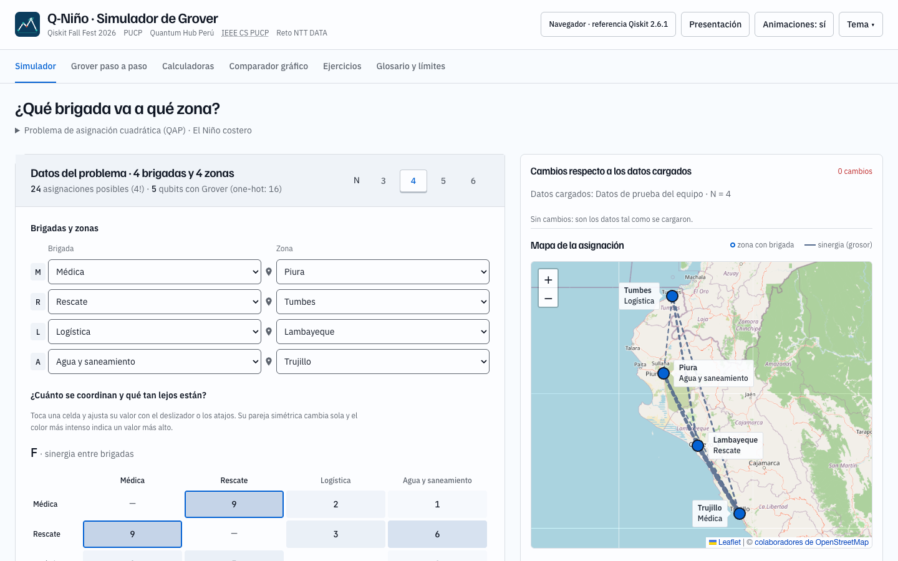
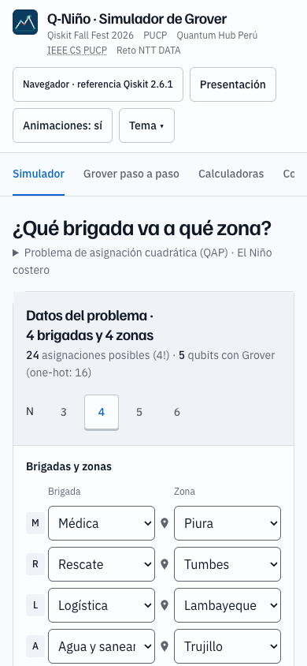

# Cobalt UI

Q-Niño uses the [Hallmark Cobalt theme](https://github.com/Nutlope/hallmark)
for all six application screens. The original scientific calculations, datasets,
Spanish explanations, logo, presentation and optional themes are preserved.
Existing saved theme preferences continue to take precedence over the new default.

The simulator preserves the existing desktop arrangement: problem editor on the
left, changes and assignment map on the right, with results beneath both columns.
The editor keeps brigade setup, the F and D matrices, then solve controls. Narrow
screens stack the editor, map and results. Calculators and charts remain usable on narrow screens through
local scrolling, readable labels and visible keyboard focus. Navigation supports
arrow keys, Home and End; animation respects the operating system's reduced-motion
preference. The map retains the latest assignment after edits, as on current main.

`css/tokens.css` defines the palette, typography and spacing. `css/base.css`
contains shared theme primitives; `css/styles.css` applies them to the app.
See [design.md](../../design.md) for the design system. Theme source revision:
`7ec868225c6caa040558c321ee0fefa0e73f83a8`. Its MIT licence is retained in
[LICENSE.hallmark.txt](../../LICENSE.hallmark.txt) and the built output.

## Build and deployment

Run `node scripts/build.mjs` using Node.js. No package installation is required.
Serve the generated `dist` directory to preview it; serving the repository root
also works for development, but exposes documentation and local review files.

Vercel reads `buildCommand: node scripts/build.mjs` and `outputDirectory: dist`
from `vercel.json`. Existing dashboard overrides must agree with those values.
The build copies only eleven runtime/licence files, strips app HTML and CSS comments,
and preserves both presentation files from current main: the animated `/slides`
version and `/slides/estatica.html`. The `/slides` rewrite and presentation link
from the merged presentation PR remain intact. Documentation is not deployed.

Merging this UI PR is left to the maintainer. Production deployment and the
production rewrite have not been verified by this UI change.

## Verification

The completed UI passed 40 browser flow checks and 43 targeted checks covering
mobile totals, chart readability, local scrolling and keyboard behaviour. All six
screens were reviewed at 1440×900, 390×844 and 1920×1080; targeted chart checks also
covered 320px and 768px widths. Hallmark reported no failures, warnings or reflex
findings; its single note was the preserved name Dürr–Høyer.

Two independent reviews approved the corrected UI and the final map-right layout. Existing reference costs for
N=3–6 remain 285, 202, 415 and 933. The seven scientific/data/logo files are unchanged.
Two Python tests passed on the earlier UI snapshot; they were not rerun for the
presentation/build integration. The optional live FastAPI/Qiskit backend was not
tested end to end. The existing browser fallback remains available.

The integration with current main passed targeted checks for the presentation
link, stale map assignments, reduced motion, reproducible output and public files.
The final layout passed desktop checks at 1440px, 1920px and 1024px, with the
editor and map aligned side by side and results spanning beneath them. Checks at
999px and 390px confirmed stacked reading order; N=6 matrices remain editable
through local scrolling, and native keyboard activation still solves correctly.
No document overflow or JavaScript errors were found in the reviewed states.

An inherited offline-map limitation remains: when Leaflet cannot load, its SVG
fallback stays hidden. This was reproduced on main and predates this change.

Before publication, the branch was rebased onto main `f919fc9`, which separately
updated the animated presentation and retained its static version. Both files
are included verbatim in the build. All eight independently approved application
assets and the licence remain byte-identical; all eleven served file hashes match
the generated output. This integration does not alter the reviewed UI.
